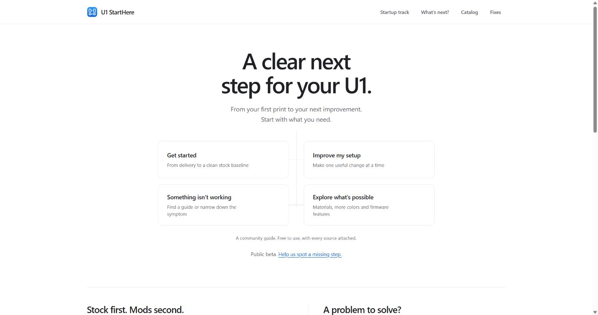

# U₁ StartHere

A community startup track, explainable upgrade planner and symptom finder for
Snapmaker U1 owners. Static files for GitHub Pages; no framework or site build.

Code and schemas: [MIT](LICENSE). Curated data: [CC BY 4.0](data/LICENSE.md),
with creator attribution embedded in every data document and record. Linked
projects keep their own licenses. This is an unofficial community project.

**[Open the public beta](https://KellenWat.github.io/u1-starthere/)** ·
[About and owner feedback](https://KellenWat.github.io/u1-starthere/about/#feedback) ·
[Embed and open data](https://KellenWat.github.io/u1-starthere/embed/)

The beta focuses on a successful first print, finding an appropriate fix and
choosing a useful next project. Source review is not physical-printer validation.
[Owner walkthrough protocol](BETA_TESTING.md) records the next validation work.



Publishing uses GitHub Pages at no domain cost. Main-branch deployment runs only
after schemas, tests and generated-page checks pass. The server publishes the
committed files without a site build. Weekly/on-demand source checks maintain
one public review issue; inaccessible pages need manual review, not invented
replacement links or automatically advanced dates.

## Milestone status

**M1 complete: local validation and GitHub Actions pass.**
Imported 38 items, 12 fixes and phases 0–6. The schemas, offline validator and
CI workflow pass locally and on GitHub. [Successful Actions run #2](https://github.com/KellenWat/u1-starthere/actions/runs/40779468443)
validated all three data files and passed all 24 tests for `a133ce3`.

**M2 complete: phone-flow acceptance and GitHub Actions pass.** Home,
filterable catalog, 38 pre-rendered item pages and the checkable startup track
are ready. Phone-sized browser testing completed the full track, including
optional skips, persistence, item links and reset. [Actions run #4 passed](https://github.com/KellenWat/u1-starthere/actions/runs/40782192085)
with all three JSON files, 25 Python tests, 11 JavaScript tests and all 41
generated pages checked. [M2 validation evidence](M2_VALIDATION.md) records
the phone/desktop checks and limits.

**M3 complete: all five golden personas and GitHub Actions pass.** The
scrolling decision path builds a deterministic plan with gate/prerequisite
ordering, visible conflict and budget explanations, reason chips, running
totals, URL sharing, ownership refinements, optional remedies and print/Markdown
exports. [Actions run #6 passed](https://github.com/KellenWat/u1-starthere/actions/runs/40791919046)
for `ba097fa`: all five golden personas, 34 JavaScript tests, 27 Python tests,
three data files and all 42 generated pages. See [M3 validation evidence](M3_VALIDATION.md).
The owner's macOS-inspired theme is applied across the site.

**M4 complete: connected guide, symptom search and all seed rankings pass locally and in CI.**
The owner's latest direction adds a shared decision map: clear observations
open matching fix cards, uncertain answers lead to another question, and goals
lead to a conditional planner. `/fixes/` searches 16 cards and 37 documented codes. Every seed
symptom and additional authored phrase ranks its own card first. Source
limitations, stop conditions and related-item links stay visible. See
[M4 validation evidence](M4_VALIDATION.md) for final local and CI evidence.
[Actions run #10 passed](https://github.com/KellenWat/u1-starthere/actions/runs/40817767600)
for `d4e0b03`: 63 JavaScript tests, 31 Python tests, four data documents and
all 43 generated pages.
**M5 complete: public beta, validation and deployment passed.** Embed/data docs,
About/feedback, review badges, weekly source monitoring and mobile/keyboard
polish are live. [Validation and deployment passed](https://github.com/KellenWat/u1-starthere/actions/runs/40939303835),
and [the first source-review run passed](https://github.com/KellenWat/u1-starthere/actions/runs/40939433035),
maintaining [the review queue](https://github.com/KellenWat/u1-starthere/issues/1).
See
[M5 validation evidence](M5_VALIDATION.md) for acceptance results. Formal M6
competition submission assets remain separate.

**Post-M4 software coverage pass:** added 25 source-reviewed guides and
classified six existing integrations, for 31 software entries in the 63-item
catalog. Eight software goals connect discovery to creator documentation and
explicit planner requests. The requested desktop/phone review led to a second
iteration: compact expandable cards, visible status, and platform filters.
See [coverage and sources](SOFTWARE_COVERAGE.md) and [validation](SOFTWARE_VALIDATION.md).
[Actions run #12 passed](https://github.com/KellenWat/u1-starthere/actions/runs/40822437238)
for `622e4d0`: 72 JavaScript tests, 34 Python tests, four JSON documents and
all 68 generated pages. All five planner personas and 12 seed rankings still pass.

M1 acceptance evidence:

| Criterion | Evidence |
| --- | --- |
| Separate project/repo scaffold | This directory, [GitHub repository](https://github.com/KellenWat/u1-starthere), licenses, `.nojekyll`, `.gitignore` |
| JSON Schemas and seed import | Three data documents; item, fix, phase and shared schemas in `schemas/` |
| npm-less validation locally | `python scripts/validate.py`: all three documents and relationship checks pass |
| Validation in Actions | [Run #2 passed](https://github.com/KellenWat/u1-starthere/actions/runs/40779468443): the same validator and 24 tests on Ubuntu/Python 3.11; workflow also supports PRs and manual dispatch |
| DATA.md written | [Data contract and contribution procedure](DATA.md) |

## Validate locally

Python 3.11+ is needed for data checks and Node 22+ for authoring/JavaScript
checks. No npm installation is required. From this directory (Windows):

```powershell
python -m venv .venv
.venv\Scripts\python -m pip install -r requirements-dev.txt
.venv\Scripts\python scripts/validate.py
.venv\Scripts\python -m unittest discover -s tests -v
node --test tests/*.test.mjs
node scripts/render.mjs --check
```

On macOS/Linux use `.venv/bin/python` for the Python commands. CI installs
the same requirements into its disposable runner and uses `python` directly.
The format extras are required: validation fails explicitly if the URI checker
is unavailable, rather than silently skipping source URL format validation.

Node 22+ is needed for authoring and JavaScript tests, with no npm install.
The JSON Schema validator resolves only local schemas and does not fetch
third-party links. External checks run separately in Weekly source review.
The suites cover seed integrity, page links, catalog filters, saved progress,
project-prefix routing and escaped content. Planner persona/invariant and
export tests also run in that Node command. M4 adds symptom rankings,
connected-route checks, follow-ups and conditional intake coverage.

## Local preview

From this directory, serve the committed site directly:

```powershell
python -m http.server 8000 --bind 127.0.0.1
```

Open http://127.0.0.1:8000/ for home, `/start/` for the track, `/catalog/`
for the catalog, or `/plan/` for the scrolling decision path. Trailing slashes work with plain static servers and GitHub
Pages. Item pages have real `/item/{id}/index.html` files, so direct links
work without a server router. No site build or runtime dependency is needed.

After editing JSON content or `templates/page.html`, run
`node scripts/render.mjs` and commit its generated files. CI checks that they
match the JSON. The optional authoring script is not a deployment build step.

## Decisions

1. **Specification priority:** the supplied `u1-starthere-brief.md` governs
   product behavior. `snapmaker-u1-first-week-checklist.md` supplies seed facts,
   sequence and historical prices. Both were read completely before code was
   written. Neither original document is copied into this repository.
2. **Recommended architecture:** vanilla HTML/CSS/JS, one small CSS file, no
   framework, no deployment build step, no backend, no accounts, no analytics,
   no cookies. Future track progress uses localStorage only. JavaScript must
   total less than 200,000 bytes; the M1 validator enforces that limit.
3. **Recommended item routes:** M2 will use checked-in, pre-rendered item HTML
   from a small optional generator. Regeneration is an authoring operation;
   GitHub Pages serves the committed files without a build. JSON remains the
   sole authored source for item content. M2 implements this using a small
   Node script and shared view helpers, without dependencies or npm.
4. **Recommended name and appearance:** `u1-starthere`; clean, mobile-first,
   visually compatible with the printer ecosystem and clearly unofficial.
   No domain, fund submission or Pages hosting has been configured yet.
5. **Versioned data:** all three JSON files use a `version`, `license`,
   `imported_at`, `attribution` envelope plus `items`, `fixes` or `phases`.
   The brief's record fields and phase ordering remain intact inside it.
   This reconciles its array examples with the explicit versioned API goal.
6. **Prices:** preserve the checklist's 2026-10-26 figures. Exact estimates
   stay estimates in `cost_note`; ranges use their upper bound (paver $8,
   LEDs $18, cooling $40, SAMLA $20). Space Pi uses Creality's listed $159;
   its $149/$158.99/$179 alternatives remain in the note. Liber uses the
   $99 four-pack; the $34.99 single price remains in the note. Variable
   expansion costs are `null`, never zero. Free model prices exclude
   filament, power and optional purchased hardware, which are disclosed.
7. **Spares arithmetic:** brushes/pads $3.99 + two wipers at $3.99 each +
   screw set $4.99 = $16.96; with a $64.99 head this is $81.95 before
   shipping/tax. Keep those line prices rather than the checklist's ~$78
   combined estimate. Do not reproduce its approximate week-one totals as
   computed plan totals. LED, paver and small parts range totals $53–61,
   another reason to calculate future plan totals from selected records.
8. **Verification honesty:** `last_verified` is 2026-10-28 as required for
   import, but every record also says `imported-not-tested` or
   `source-reviewed-not-tested`. `verified_firmware` is `null` throughout.
   No printer tests or firmware compatibility tests were performed. Future
   badges must say imported/source reviewed, firmware not tested; never
   imply firmware verification from the import date alone. Firmware minimum
   requirements imported from the checklist remain requirements to check,
   not proof of compatibility. Newer integration details seen during source
   review do not replace the seed prices or claim tested support.
9. **Attribution:** use named creators where supplied or confirmed on their
   own pages. A `null` creator plus `credit_status: pending` and an explicit
   note preserves unresolved attribution without inventing a handle. A
   manufacturer or retailer homepage is a disclosed fallback, not an exact
   product/model link. Original third-party files are never rehosted, and
   affiliate/tracking query parameters are rejected by validation.
10. **Seed extensions:** split firmware integrations into individual setting
    records for the already-on-Paxx12 persona. Split multiACE and Sidecar to
    credit their different creators. Add an explicit enclosure-gated ABS/ASA
    preparation step so a passive enclosure can unlock an ABS plan without
    implying an active heater is necessary. Full Spectrum and three
    brief-only fixes are explicitly identified as brief imports.
11. **Planner data, not an engine yet:** `requires` holds item prerequisites;
    `gates` grants capabilities; `conditions.required_gates` requests them.
    Enclosure alternatives and hardware expansion routes have symmetric
    conflicts. `optional_related_items` never imposes a purchase. Numeric
    score weights, gate choice tie breaks, ownership mapping, and unknown
    cost handling will be documented and tested when M3 is authorized; no
    planner is implemented during M1.
12. **Time and difficulty:** all `time_minutes` and difficulty values are
    editorial planning estimates, not measured benchmarks. Print duration
    and setup time depend on the chosen part and profile. Nozzle and bed
    temperature settings are not treated as verified printer defaults.
13. **Safety and support:** cards use plain-English rewrites with explicit
    stop conditions and official support links. Unverified recovery advice
    stays conditional on the current official procedure. Driver-temperature
    anecdotes do not establish safe processor temperatures. A closed lid or
    filtering mode is not an air-quality certification. OpenSpool cannot
    identify a tag that remains out of reader range in a distant dryer.
14. **Scope:** owner-specific price-match deadlines, local used-item alerts,
    supplied-document instructions to download firmware/models, and private
    travel details are not website features or instructions to this agent.
    Do not ship downloads, campaigns, personal deadlines or a code decoder.
15. **Hosting:** the requested GitHub Pages workflow takes priority over a
    plugin-hosted Site. No Sites registration or deployment is performed.
    Created the public `KellenWat/u1-starthere` repository to support the
    intended $0 GitHub Pages deployment, and configured it as `origin`.
    No website has been deployed yet. The connector lacks repository
    creation, so creation used the signed-in GitHub browser; pushes use Git.
    Actions run #1 failed before tests because pip caching looked for the
    default requirements filename. Set `cache-dependency-path` to
    `requirements-dev.txt`; the new run #2 passed validation and all 24 tests.
16. **What’s next interface (owner direction):** M3 will use an interactive,
    scrolling decision path that branches toward relevant community options
    and original creator pages. Show one skippable question at a time, retain
    earlier answers, and allow backtracking/changes. Use normal scrolling and
    keyboard controls. Keep the brief's deterministic ordering, prerequisites,
    conflicts, reason chips and visible budget deferrals. This changes the
    intake presentation, not the planner rules. No M3 engine is built in M2.
17. **Honest M2 navigation:** until the planner exists, the home page's second
    action opens the working catalog rather than a dead planner link. It
    previews the future decision path in plain language. Symptom search stays
    in M4; M2 links owners to official U1 support without a fake search field.
18. **Optional track choices:** contract 1.1.0 adds `steps[].optional` (default
    false) to phases. Purchases and modifications can be explicitly skipped.
    The nine required steps cover preparation, inspection, stock tests and a
    firmware decision; staying stock is valid. Twenty-two optional steps can
    be completed or skipped. Checks do not verify actual printer behavior.
19. **Progress and filters:** track-only localStorage, under a versioned key;
    the UI distinguishes completed from skipped steps and permits reset with
    an accessible confirmation dialog. Filter state uses the URL query.
    No cookies, remote fonts, analytics, storage for other purposes, or
    automatic network calls to creator pages are introduced.
20. **Original M2 visual direction:** a white/cool-gray field guide with blue controls,
    local system fonts, a four-toolhead mark, and large checklist labels.
    Tested at 320 px and 390 px phone widths and a 1280 px desktop viewport.
    See [DESIGN.md](DESIGN.md) for tokens and rationale. M5 still owns the full
    accessibility/freshness polish pass; these are the M2 usability checks.
    The owner's macOS direction below supersedes this visual treatment.
21. **M3 defaults and ownership:** stock/assembled, basic materials, no
    enclosure, $50, no selected concerns, no firmware/soldering, office.
    General stock/modded stage answers imply preparation/assembly only;
    burn-in and specific mods are never guessed. Already-on-Paxx12 adds only
    that firmware to the known setup, with separate settings still offered.
    `done_for_stages` and `done_for_enclosures` live in JSON. Per-item actions
    refine ownership and optional requests without adding intake questions.
22. **Deterministic scoring and ties:** 100 per concern match, 10 per specific
    material match (1 for general/all), 20 per location match. Kahn ordering
    chooses prerequisite-ready items by phase, descending score, then stable
    code-point ID. Alternative routes use relevance, known affordability,
    lower cost and ID. See [PLANNER.md](PLANNER.md) for the full algorithm.
23. **Budget and quotes:** integer cents, greedy fill in sorted order, with
    prerequisites deferred together. A selected route that does not fit
    remains visibly deferred while a cheaper compatible route is tried; no
    earlier purchase is evicted. Unknown costs require a quote, never $0.
    The $300+ intake choice uses a conservative $300 cap, shown in the output.
24. **Data contract 1.2.0:** optional purchases and the checklist's "buy when
    needed" triggers are explicit `on_request`, `interests_any` and
    `materials_any` conditions. A request or required gate bypasses an
    interest/optional trigger, but cannot bypass materials, firmware or
    soldering restrictions. `after_selected` orders recalibration after
    chosen base/riser/cover changes without making those purchases mandatory.
    No item prices, source credits or verification dates were advanced.
25. **Owner-requested macOS theme:** replaced M2's display font and blue
    field-guide panels with Apple system typography when available, native
    fallbacks, a frosted desktop toolbar, segmented navigation, quiet gray
    canvas, rounded white panels and blue controls. Our four-toolhead mark
    becomes a blue app-style icon. No Apple artwork, remote fonts, UI library
    or new dependency. The theme applies across all M2/M3 pages and keeps
    native form controls and visible keyboard focus.
26. **Sharing and exports:** versioned URL-hash state only; no planner
    localStorage, backend or printer connection. Normal scrolling plus
    explicit advancement; earlier answers remain editable. Print
    view separates shopping and printed parts, and includes full guidance;
    Markdown retains reasons, warnings, exclusions and creator credits.
    Clipboard failure exposes selectable text. Invalid links fall back with
    a notice. Keyboard skip-to-content preserves the encoded answers.
27. **Minimal decision diagram (owner refinement):** each question now fills
    a screen, with connected rectangular choice nodes and automatic scrolling
    after a single choice. Selecting an existing default also advances. Earlier
    screens remain editable through ordinary scrolling or Back. The concerns
    question allows zero, one or two selections and uses a connected Continue
    node so the first selection does not unexpectedly end that choice. The
    sidebar and accordion intake are removed. Shared links open the plan with
    Edit answers. Native buttons work with Tab, Enter and Space; focus follows
    the next question, and reduced motion uses immediate scrolling. This is
    an M3 presentation refinement; planner rules and M4 scope stay unchanged.
28. **Interconnected map (owner direction):** M4 connects setup, improvement,
    exploration and symptom paths through shared nodes. A specific observation
    opens an existing fix card; uncertain answers ask a clarifier or offer
    search/support. This is navigation, not an automated diagnosis. Fixes offer
    helped/still-happening follow-ups and explicit related-option planning.
    Editing an earlier route replays only the retained choices; later effects
    are removed. Revisiting a shared question truncates the loop. The map is
    available in a keyboard-usable dialog, with links to individual guides.
29. **Routing data:** `data/journey.json` is a fourth CC BY 4.0 document with
    embedded source attribution. Its 30 nodes reference fix IDs rather than
    duplicating repair steps, catalog facts, prices or verification dates.
    Schema and relationship validation now cover all four documents. Catalog,
    fix and phase formats remain at 1.2.0; existing consumers remain valid.
30. **Conditional intake and assumptions:** at most the seven original
    planner inputs, skipping fields already explicitly selected in the map.
    Enclosure is asked for ABS/ASA or noise/fume routes; location for noise/fume
    routes. Stage, materials, concerns, comfort and budget are otherwise
    available, with the same conservative defaults. Results expose every
    answer/default and allow individual edits. Reported hardware state is
    never inferred from a diagnostic symptom. Planner rules are unchanged.
31. **Search and evidence:** normalized keyword matching over title, symptoms
    and optional code keywords, with exact-phrase priority, coverage and rare
    word weighting; stable ID ties, no library or ML. Blank search lists cards;
    unrelated queries return an honest empty state. A source index is disclosed
    as such; no imported record gained a verification claim. Search and route
    state live in URLs only. No additional browser storage or tracking.
32. **Software coverage (owner request):** document the missing plugins,
    firmware features, companion apps, integrations and reader hardware as
    distinct types. New software is `on_request`; unknown service, platform or
    hardware prices remain variable. Firmware prerequisites and stock burn-in
    still apply to requested printer-side features. Eight goal-based resource
    groups reference catalog IDs without copying their content into JS.
33. **Source status:** guides are source-reviewed, not installed or tested.
    Experimental, beta, proof-of-concept and unmaintained status remains
    visible. SpoolTagger and baze reader metadata relies on the firmware
    directory where creator documentation could not be read; that limitation
    is disclosed. Current SpoolKid development is newer than its public code
    snapshot. No claim of exhaustive community coverage or tested firmware.
34. **Contract 1.3.0:** optional `software` metadata provides platform,
    status, firmware/account/hardware/license notes, setup outline and credited
    documentation links. Journey `resources` nodes reference `item_ids`.
    Validation covers these references and outbound documentation URLs.
    Existing IDs and version-1 plan/journey links remain supported.
35. **Second iteration after review:** compact cards with expandable
    requirements, visible status and platform filtering replace tall software
    comparison panels. The catalog also exposes a Software & integrations
    category and platform filter. Resource filters last for the current visit;
    catalog filters are shareable in the URL. No added browser storage.

36. **Owner-requested code mappings (2026-10-29):** the later request to add
    error-code-to-fix guidance extends the brief's original keyword-only scope.
    Contract 1.4.0 stores 37 explicit mappings across eight fault/notice families
    in `fixes.json`, with credited evidence, dates and source-review status.
    This is a curated lookup; unknown codes link to the official reference.
    No numeric prefix is interpreted as a diagnosis or a printer command.
37. **Corrected seed association:** `0002-0523-0001-0045` belongs to the new
    pogo-contact fault card, not the reminder-loop card. Maintenance notice
    `0001-0523-0000-0037` remains separate. All mappings were checked against
    Snapmaker's table and linked articles; no printer/firmware testing is claimed.
38. **Mixed community evidence:** the homing card credits the forum reports
    by edstewbob, 0rfar and ni42. Centering helped some owners and failed for
    another, who received a replacement. Keep the official checks first and
    do not present the anecdote as a guaranteed current-firmware repair.
39. **Code search behavior:** one complete identifier is required. Normalize
    spaces/hyphens or compact digits, reject partial/multiple identifiers, and
    never substitute a similar number. Keep symptom search available separately.
    Expandable code evidence follows the checks to keep stop conditions visible
    on a phone. All four new guides are reachable in the connected journey.
40. **Visible codes beside fixes:** per the owner's follow-up, all associated
    numbers now appear beneath each fix title in the results list, including
    collapsed results. Journey cards show the same complete codes before the
    checks. Only source/review notes remain expandable; codes are never hidden
    behind that disclosure. Number lists wrap on phones and render from JSON.
41. **Design refinement:** retain the owner's minimal Apple/macOS direction,
    with a white canvas, a compact header, native typography, quieter borders
    and fewer competing panels. Utility pages are left aligned; full-screen
    decision questions stay centered. No fonts, imagery or dependencies added.
42. **Homepage as a working entrance:** its four choices come directly from
    journey.json and link to the corresponding restored path. Startup phases
    and catalog highlights still render from JSON. Nonempty restored journeys
    bring the active question into view, with reduced-motion behavior preserved.
43. **Phone usability after review:** a divided fix list keeps every documented
    code visible, category uses the full filter row, and difficulty/stage live
    in a keyboard-operable disclosure with an active count. Shared URLs open
    those extra filters when needed. Track stage links scroll in one row.
    This is a design iteration; M5 embed/freshness and M6 remain deferred.

44. **First-print audit:** address the missing bridge between assembly and
    printing before encouraging community upgrades. Contract 1.5.0 adds eight
    guided assembly/first-use checks with prerequisites, instructions, observable
    completion criteria, recovery advice and credited official sources.
45. **Material scope:** the beginner loading route follows official PLA/PETG
    automatic-loading guidance. TPU links to the dedicated manual-loading guide.
    A missing RFID label leads to material/color entry, not an assumed fault.
46. **Readiness and saved progress:** retain existing version-1 progress and
    stable IDs, leaving new checks unchecked. Readiness milestones include
    prerequisites and offer one next unchecked action. Optional purchases and
    modifications never gate the first print. Checks are owner-recorded, not
    machine-verified.
47. **File assumptions:** do not assume a demo is preinstalled. Offer a local
    compatible demo conditionally, otherwise an official test model sliced for
    the U1. Explain LAN upload versus starting a print. Do not invent an offline
    SD/USB transfer procedure from inconsistent documentation.
48. **Evidence limits:** the walkthrough uses documentation review and browser
    scenarios, not recruited participants or a physical U1 print. Source review
    is labeled accordingly. [Owner journey audit](USER_JOURNEY_AUDIT.md) records
    findings, changes, validation and remaining usability questions. The current
    track had 38 steps; the connected journey had 48 nodes. M5/M6 were deferred
    at that audit; the current M5 status is recorded above.

49. **Useful first prints:** the owner's follow-up adds ahlang's split waste
    chute/box and Darien's deflector wall. Setup, improvement and exploration
    link to one shared group. Both remain optional phase-3 choices after stock
    tests; no automatic planner selection or assumed free filament cost.
    Creator announcements establish authorship and purpose. Their linked model
    pages could not be read by the research tool, so do not claim a latest
    revision, specific print settings, license or tested combined compatibility.
    Current files and installation stay on the creator's own page. The generic
    resources view now distinguishes printed parts from software controls.

50. **Forum review across usage levels:** nine model links now form three
    groups: early cleanup/storage, everyday convenience, and advanced enclosure/
    cooling projects. The new-owner route opens the early group; improvement
    and exploration first ask which kind of project would help. Contract 1.6.0
    stores linked `community_evidence` separately from the original model URL.
    Unknown project costs remain quotes, all additions are opt-in, advanced
    electrical routes respect the existing skill limits, and no new project
    claims to provide a thermal-safety capability. See
    [forum print review](FORUM_PRINT_REVIEW.md) for sources and deferred leads.

51. **Public beta and M5:** freeze feature categories and gather real owner
    walkthroughs. Add About/privacy/credit policy, GitHub feedback templates,
    reusable embed cards and honest source/firmware badges. No real-owner or
    physical-print validation is claimed before those observations exist.
52. **Freshness policy:** weekly plus manual Actions runs use 45 whole UTC days,
    one bot-owned review issue and report artifacts. Treat 403/429/network errors
    as manual review; only 404/410 means a confirmed failed link. Never update
    source dates or firmware claims automatically. A local live run found 83
    unique links: 51 responded, 32 needed manual review, none returned 404/410;
    eight primary creator credits remain unresolved.
53. **Publishing:** the owner explicitly authorized making the website public.
    The repository was already public. GitHub Pages uses the existing main
    branch through a test-gated Actions deployment, serving committed files
    without a site build. No custom domain or paid hosting is required.
    This early beta replaces the brief's suggested late-November soft launch
    at the owner's request.

54. **Suggestions:** every page's shared footer now has a Something missing?
    button opening a dedicated GitHub suggestion form. Readers can suggest a
    guide, fix, project or usability improvement, with an optional original
    creator link and page context. The button discloses the GitHub account
    requirement; the About page links to the same form.

55. **Wordmark:** display the site name as U₁ StartHere, with a smaller subscript
    1 in the header/footer and Unicode subscript in page titles. Accessible
    link names remain readable as U1 StartHere.

## Source review and remaining content work

Source pages were reviewed on 2026-10-28 for Paxx12, its RFID/Spoolman/heater
documentation, tonsofbuns' VFA report, the Liber manufacturer listing,
Dragon2203's converter, decay71's multiACE, dcan999's Sidecar preview, and
ratdoux's Full Spectrum repository. Per-record sources link directly to those
pages. Review means documentation review, not reproduced hardware behavior.

Deferred source gaps are explicit in the data:

- Printables riser and SAMLA URLs could not be fetched; the PTFE example's
  MakerWorld fetch was blocked. Supplied URLs are preserved; designer handles
  need confirmation.
- Exact TPU holder, tool-holder/spool-adapter, LED and small-parts products
  were not supplied. Their model/manufacturer credits need resolution.
- BIQU PopCap, PopStatus and PopStation Mini retain a manufacturer homepage
  fallback pending exact product URLs. Generic support-index links on fixes
  are labeled as such and do not substantiate symptom-specific claims.
- Homing, nozzle/calibration, loading-sensor and pogo guidance received specific
  source review on 2026-10-29. [Code coverage](ERROR_CODE_COVERAGE.md) records
  the supported families and correction to the seed example. Source review is
  not a reproduced repair. The cover-mode card still needs specific review.
- Sidecar's source currently describes a development preview, not a ready
  installation. Preserve that warning in future catalog and planner output.

## Next milestones

The public beta includes M5. Gather real owner observations using BETA_TESTING.md
and fix demonstrated blockers. M6 submission assets follow the M5 acceptance
handoff; formal community posting needs the owner's instruction.
